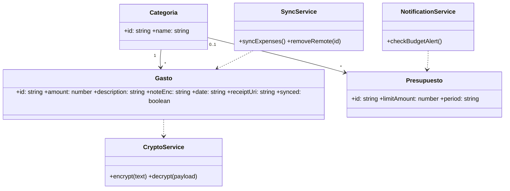

# Reporte técnico — Gestión de gastos personales
David Ariel Cortes Castellanos

## 1. Stack
React Native + Expo + TypeScript, Supabase (Auth, Postgres) y SQLite local (expo-sqlite), según el análisis de la Unidad I.

## 2. Diagrama de clases

Renderízalo en https://mermaid.live y expórtalo como imagen para el PDF.

## 3. Modelo de datos
| Tabla | Campos | Relación |
|---|---|---|
| categories | id PK, name UNIQUE | — |
| expenses | id PK, amount, description, note_enc, category_id FK, date, receipt_uri, synced | N:1 categories |
| budgets | id PK, category_id FK NULL, limit_amount, period | N:1 categories |

Nube: tabla `public.expenses` en Supabase con `user_id` (sin notas ni rutas de fotos).

## 4. Mecanismos de seguridad
- **Cifrado local:** notas con AES-256-CTR (aes-js), IV aleatorio por registro; la llave se genera al primer uso y se guarda en Keystore/Keychain con expo-secure-store.
- **Autenticación:** Supabase Auth (email/contraseña, JWT); el SDK renueva el token y persiste la sesión en AsyncStorage.
- **Biometría:** expo-local-authentication desbloquea la app al abrirla.
- **Validación de entradas:** esquemas zod en gastos, presupuesto y credenciales.
- **SQL seguro:** consultas parametrizadas (sin concatenar strings).
- **Secretos:** credenciales en `.env` (excluido de Git) y Row Level Security en Postgres (cada usuario solo accede a sus filas; solo se usa la anon key en la app).
- **Privacidad en nube:** los campos sensibles no se suben.

## 5. Librerías de terceros
zod (validación), date-fns (fechas), aes-js (cifrado), Intl (formato de moneda).
